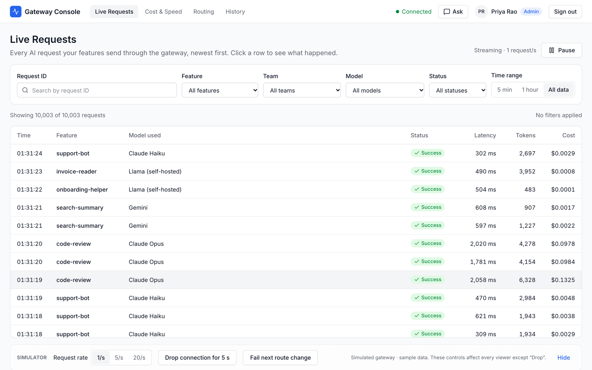
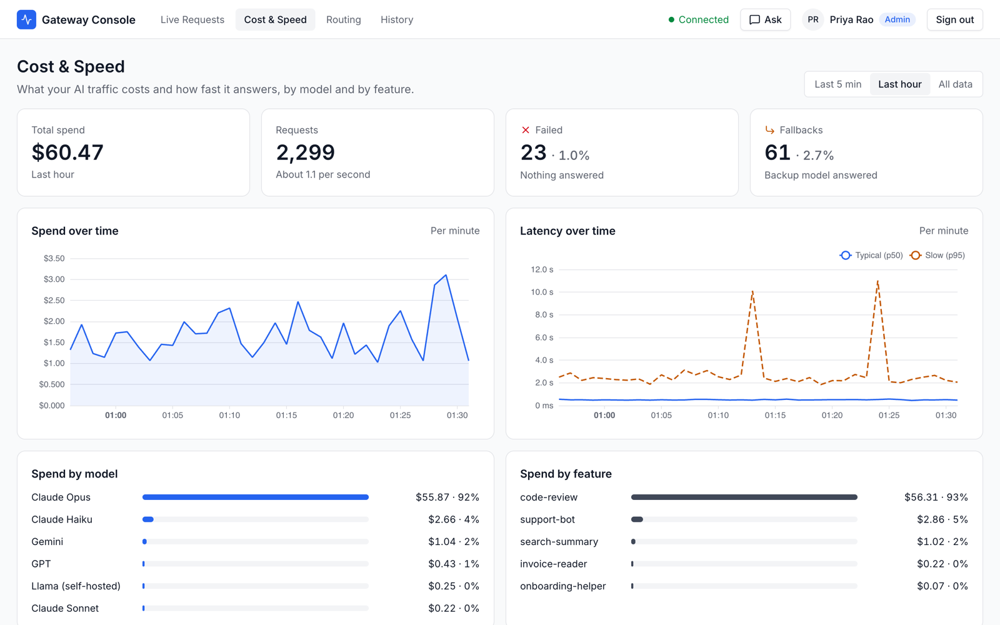
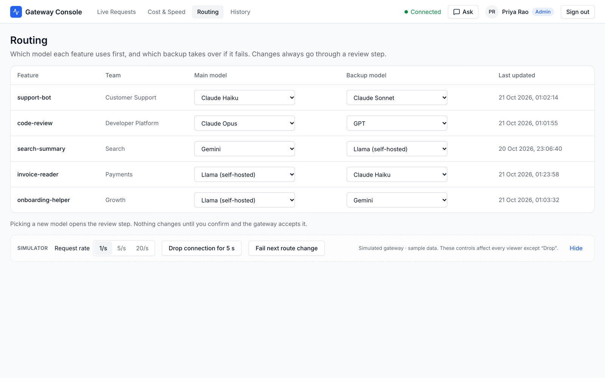
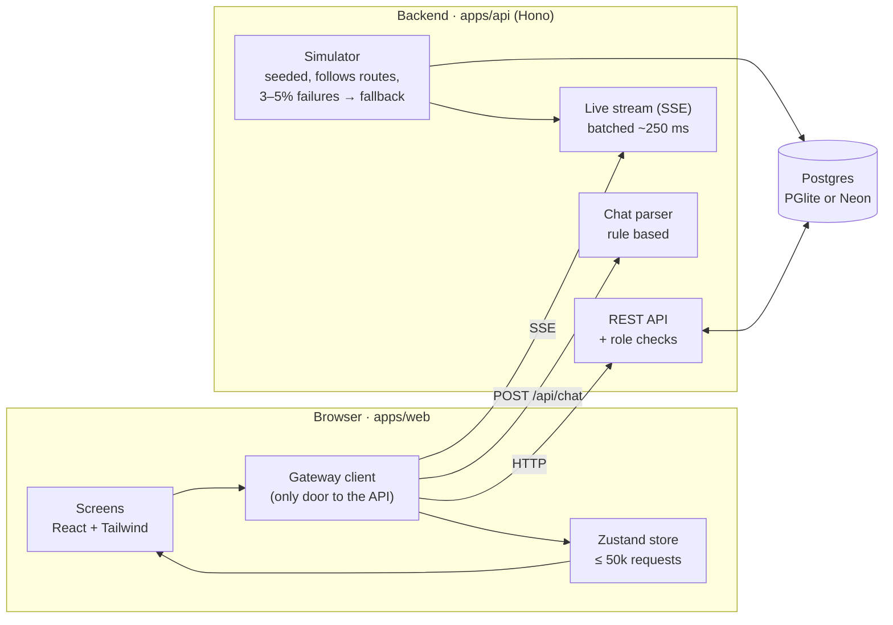

<div align="center">

# AI Gateway Console

**See every AI request. Understand what it costs. Change model routing safely.**

A web console for teams that run many AI features (support bots, code review, search…) across many models (Claude, GPT, Gemini, Grok, self-hosted).




</div>

> [!NOTE]
> **All traffic is simulated.** No real AI model is called and no real money is spent. A seeded simulator in the backend creates realistic requests, failures and fallbacks. Prices are example values. See [What is real and what is simulated](#what-is-real-and-what-is-simulated).

---

## Why this project exists

Companies now use AI inside many products. One team uses it for customer support, another for code review, another for search, each talking to a different model. As this grows, nobody can easily answer simple questions:

- Which feature is using which model right now?
- How much is each model costing us?
- Why did this request fail? Did it switch to a backup model?
- A model is too expensive or too slow. How do we move traffic safely?

The answers usually hide in logs, bills and scripts, and changing a model means asking an engineer to change code.

**AI Gateway Console puts it all in one place.** Anyone on the team can watch traffic live, see where the money goes, and move a feature to another model in a few clicks, with a review step before anything changes.

## What you can do

| | Screen | What it does |
|---|---|---|
| 📡 | **Live Requests** | Every request as it happens: feature, model, status, latency, tokens, cost. Filter by feature, team, model, status and time. Click a row to see what happened, including fallbacks. Stays smooth with 10,000+ rows. |
| 💸 | **Cost & Speed** | Total spend, request count, failures and fallbacks. Spend and latency (p50 / p95) over time, spend by model and by feature. |
| 🔀 | **Routing** | The main and backup model for each feature. Pick a new model → review what changes and the estimated saving → Confirm. |
| 🕓 | **History** | Every route change, newest first, with who made it and how (click, chat or undo). Undo the latest change per feature. |
| 💬 | **Ask your gateway** | Plain-language chat: *"Show failed requests from support-bot today"*, *"Move support-bot to a cheaper model"*. It filters screens and proposes changes, but **never applies them**. Only your Confirm click does. |
| 🔐 | **Roles** | Sign in as **Viewer** (read only) or **Admin** (can change routes). The check runs in the backend, not just on buttons. |

<table>
  <tr>
    <td></td>
    <td></td>
  </tr>
  <tr>
    <td align="center"><b>Cost & Speed</b></td>
    <td align="center"><b>Routing</b></td>
  </tr>
</table>

## Run it locally

You need **Node.js 22+** (the repo pins 24 in `.nvmrc`) and **pnpm 10**. No database and no API keys are needed.

```bash
# 1. Clone
git clone https://github.com/ROHITCNF/ai-gateway-console.git
cd ai-gateway-console

# 2. Use the pinned Node version and enable pnpm
nvm use            # optional, if you use nvm
corepack enable    # provides the pnpm version set in package.json

# 3. Install
pnpm install

# 4. Start the backend (port 8787) and the console (port 5173)
pnpm dev
```

Open **http://localhost:5173**, type any name, pick **Admin** or **Viewer**, and sign in.

On first start the backend seeds **10,000 requests** covering the last 3 hours, then keeps adding about one per second. The data lives in an embedded Postgres ([PGlite](https://pglite.dev)) under `apps/api/.data/`, so nothing else needs installing. Delete that folder to start fresh.

### Things to try

1. **Watch traffic.** On *Live Requests*, filter by `Status: Failed` and click a row to see the backup model take over.
2. **Turn up the load.** In the *Simulator* bar at the bottom, switch to `20/s` and scroll the table.
3. **Change a route.** As Admin, go to *Routing*, pick a cheaper main model for `code-review`, read the estimate, and Confirm. Check *History*, then Undo.
4. **Ask in plain language.** Click **Ask** and try *"Show failed requests from support-bot today"* or *"How much did the payments team spend in the last hour?"*
5. **Try it as a Viewer.** Sign out, sign in as Viewer, and see that routing is read only.
6. **Break things on purpose.** Use *Fail next route change* or *Drop connection for 5 s* to see the error and reconnect states.

### Optional configuration

Copy `apps/api/.env.example` to `apps/api/.env` to change defaults. Everything is optional.

| Variable | Default | What it does |
|---|---|---|
| `PORT` | `8787` | Port the API listens on. |
| `DATABASE_URL` | *(unset)* | Use a real Postgres (e.g. a Neon branch) instead of PGlite. |
| `PGLITE_DIR` | `.data/pglite` | Where PGlite stores data when `DATABASE_URL` is unset. |
| `SIM_SEED` | `42` | Simulator seed. Same seed, same data. |
| `SIM_RATE` | `1` | Requests per second (`1`, `5` or `20`). |
| `SIM_ENABLED` | `true` | `false` stops the simulator from writing. |
| `SESSION_SECRET` | *(random)* | Signs session cookies. Generated and stored locally if unset. |

### Scripts

| Command | What it does |
|---|---|
| `pnpm dev` | Run API and console together with hot reload. |
| `pnpm test` | Run all tests (Vitest; tests always use an in-memory PGlite). |
| `pnpm lint` / `pnpm format` | Check / fix code style with Biome. |
| `pnpm typecheck` | Type-check every package. |
| `pnpm build` | Production build. |

## How it works



The browser loads a snapshot of recent requests, then follows a live Server-Sent Events stream. Filters and charts run on the in-browser store, so they stay fast. Every route change goes through the backend, which checks the role, applies the change, records history, and only then confirms.

```
apps/
  web/          React console (Vite, Tailwind v4, shadcn/ui, TanStack Table + Virtual, ECharts)
  api/          Hono backend: simulator, REST + SSE, sessions, chat parser, Drizzle + Postgres
packages/
  contracts/    Zod schemas and types shared by web and api, plus example model prices
docs/           intent, spec, decisions, plan
```

## Key decisions

The full list, with reasons, is in **[`docs/decisions.md`](docs/decisions.md)**. The ones that shape the product most:

- **Review before apply.** Every route change, whether from a click, the chat or an undo, goes through the same review step: old → new model, estimated cost change, then Confirm. The screen shows the new route only after the backend confirms it.
- **The chat can propose, never apply.** The chat returns an action from a fixed allow-list and always shows what it understood. Changing a route still needs the review step and a Confirm click, so a misunderstood sentence can't move traffic. It is rule based (no AI model) to keep it free, predictable and testable, and sits behind one interface so an AI version can replace it later.
- **Permission checks live in the backend.** The UI disables controls for Viewers, but the real check is in the route-change handler. A crafted request from a Viewer gets `403`.
- **Built for 10,000+ rows.** The table is virtualised (only visible rows are drawn), requests live in a store outside React components, live updates arrive in ~250 ms batches, and charts read time-bucket totals instead of raw rows.
- **One seam to a real gateway.** Screens never call `fetch`. They talk to one gateway client, so the simulated backend can be swapped for a real gateway without touching the screens.
- **Runs after a fresh clone.** PGlite (Postgres compiled to run inside Node) means no database setup. Set `DATABASE_URL` to use a real Postgres instead.

## Performance

Targets: scroll at **60 fps with 10,000 rows**, filters respond in **under 100 ms**, and no input freeze at **20 requests/second**.

> Measured numbers, the method used, and one before/after improvement are added in task 7.1 ([#36](https://github.com/ROHITCNF/ai-gateway-console/issues/36)).

## What is real and what is simulated

| Real | Simulated |
|---|---|
| The console, its screens, filters and charts | All AI traffic (no model is ever called) |
| The backend API, live stream and Postgres storage | Model prices (example values in `packages/contracts/src/catalog.ts`) |
| Route changes, history, undo, and backend role checks | Sign-in (pick a name and role, no passwords) |
| The chat's request understanding (rule based) | Features, teams and models (5 features, 7 models) |

See [`docs/decisions.md`](docs/decisions.md) (D1–D6, D11, D15) for why.

## Out of scope

Real accounts, real model calls or billing, email/chat alerts, and a phone-first layout. The console is designed for laptop screens.

## Project docs

- [`docs/intent.md`](docs/intent.md): the problem and what success looks like.
- [`docs/spec.md`](docs/spec.md): screens, requirements (FR / NFR), data and flows.
- [`docs/decisions.md`](docs/decisions.md): how it's built and where it's simplified.
- [`docs/plan.md`](docs/plan.md): the build checklist.
